# Thymio 3 — Cartes

Programmer le **mode Séquence** du Thymio 3 avec des **cartes**, sur une tablette ou un téléphone,
à l'âge de 6 ans.

**Démo en ligne : <https://francescomondada.github.io/thymio3-cards/>** (robot virtuel).
Avec un **robot de démonstration** qui joue le rôle du Bluetooth (connexion, relance à chaque carte,
journal) : <https://francescomondada.github.io/thymio3-cards/?fakerobot>. Avec un vrai robot, il faut
Chrome ou Edge (Web Bluetooth), ou **Bluefy** sur iPhone et iPad (voir plus bas).

On touche (ou on glisse) des cartes *Avance*, *Recule*, *Tourne à gauche*, *Tourne à droite* pour
construire un programme, puis on appuie sur **C'est parti !** : le robot le rejoue. Sans robot, un
**robot virtuel** joue le même programme sur un tapis quadrillé, avec la même mécanique.

**Cartes à imprimer pour la classe : [`docs/cartes-thymio.pdf`](docs/cartes-thymio.pdf)** (5 pages A4 : les
instructions, 64 cartes de 45 mm à découper, et une page de cartes en grand à montrer à la classe, les mêmes
pictogrammes que l'application).

**Sol à imprimer en A0** (cases de 15 cm, lettres et numéros sur le bord) : grille vide
([PDF](docs/grille-a0.pdf), [SVG à modifier](docs/grille-a0.svg)) et exemple « ville »
([PDF](docs/grille-a0-ville.pdf), [SVG à modifier](docs/grille-a0-ville.svg)).

Même base que [`thymio3-cockpit`](https://github.com/FrancescoMondada/thymio3-cockpit) : React + Vite, et l'API
[`Mobsya/thymio3-ts-api`](https://github.com/Mobsya/thymio3-ts-api) prise directement sur GitHub
(non copiée ici). Le comportement du robot vient du firmware
[`Mobsya/thymio3-firmware-esp32`](https://github.com/Mobsya/thymio3-firmware-esp32).

```bash
npm install
npm run dev        # http://localhost:5173  (le robot virtuel marche dans tous les navigateurs)
npm test           # tests JavaScript + tests Python du mode, sur un robot virtuel
npm run build      # site statique dans dist/
```

Pour piloter un vrai robot : **Chrome ou Edge** (Web Bluetooth), sur ordinateur ou tablette
Android. Safari et Firefox, et donc **l'iPhone et l'iPad** (où tous les navigateurs, Chrome compris,
reposent sur Safari), ne savent pas faire du Web Bluetooth : l'application reste alors en simulation,
et son réglage « Pour les grands » le dit. **Sur iPhone et iPad, installer
[Bluefy](https://apps.apple.com/app/id1492822055)** (navigateur gratuit de l'App Store qui ajoute
le Web Bluetooth), y ouvrir l'adresse de l'application (HTTPS, comme sur GitHub Pages) et
connecter le robot. Non testé avec Bluefy : l'API choisit la taille des paquets en
essayant de 510 octets à 23, l'envoi du module (15 Ko, une seule fois par robot) y sera
probablement plus lent qu'avec Chrome. En cas de problème, envoyer le journal de la connexion
(voir « Déboguer la connexion »). Le déploiement GitHub Pages est dans `.github/workflows/deploy.yml`,
comme pour le cockpit.

## Ce qui est reproduit : le mode Séquence du firmware

Le « mode automate » est le mode magenta + cyan de `main/sequence.c` : on enregistre des pas avec
les flèches du robot, on les rejoue, on les efface en couchant le robot.

| Firmware (`sequence.c`) | Ici |
| --- | --- |
| 4 pas : avant, arrière, gauche, droite | 4 cartes, mêmes codes (`F B L R`) |
| 50 pas au maximum (`SEQUENCE_BUFFER_SIZE`) | 50 cartes ; au-delà, le robot clignote en rouge, la piste tremble |
| avant / arrière = 15 cm, minuteur matériel étalonné (`mot_15cm.dat`) | idem, durées lues sur le robot (`@@cal`) |
| gauche / droite = ±90°, cap absolu cumulé au gyroscope (`AngleController_StartAbsolute`) | idem, `rotate_deg_absolute()` ; la dérive des lignes droites est corrigée à chaque virage |
| ligne droite tenue au cap (`StraightController`, PI sur l'angle gyro brut) | porté en Python (non exposé à MicroPython) |
| pause de 0,5 s après un trajet droit, 0,7 s après un virage | idem, en temps réel |
| fin : son *end path*, la séquence est conservée, retour à l'enregistrement | idem |
| robot sur le côté = effacer le dernier pas ; sur le dos = tout effacer ; *Stop* de la télécommande | idem sur le robot ; ici : gomme (toucher) et corbeille (garder appuyé 1 s) |
| *Go* de la télécommande, ou main passée sur les capteurs arrière | idem sur le robot ; ici : le bouton **C'est parti !** |
| LED Lego = nombre de pas, LED du cercle = direction du pas, pulsation magenta / cyan | idem sur le robot et sur l'avatar du robot virtuel |
| bouton central = quitter le mode | idem |

En plus du firmware : insérer une carte entre deux autres, déplacer, supprimer n'importe laquelle,
voir le chemin prévu sur le tapis sur demande, voir la carte en cours, des sons, des programmes
d'exemple, et une page pour l'adulte en quatre langues (FR / EN / DE / IT).

Non reproduit : la détection d'obstacle de `sequence.c` est entièrement commentée dans le firmware
(`CheckCollisionStatus`), elle ne l'est pas ici non plus ; deux flèches pressées dans le même
instant ne créent pas de pas « double ».

## Les cartes à disposition : modes normal, avancé et personnalisé

Réglages (icône du robot orange) → **Mode** (retenu par l'appareil). Il choisit les cartes que les enfants
ont dans la palette, pour des exercices plus précis ou une approche pas à pas :

| Mode | Cartes à disposition |
| --- | --- |
| **Normal** (au départ) | les quatre pas : avance, recule, gauche, droite |
| **Avancé** | en plus : `(` `)`, répéter, « si le sol est… » et « tant que le sol est… » (voir ci-dessous) |
| **Personnalisé** | celles que l'adulte donne : neuf cartes à toucher dans les réglages (les quatre pas, `(`, `)`, répéter ×N, répéter avec une couleur, « si ») ; une carte donnée a une coche, une carte retirée est pâle. La dernière carte donnée ne peut pas être retirée |

En mode personnalisé, la palette ne montre que les cartes données (une seule carte « répéter » quand le
nombre et la couleur sont donnés tous deux ; ses choix, une fois sélectionnée, ne proposent que ce qui est
donné). Le pinceau du tapis (et le sol de l'image) n'existent que si une carte regarde le sol, « si » ou
« tant que ». Les cartes déjà dans le programme restent même si le mode ne les donne plus, et marchent
(le programme est le même sur le robot) ; les exemples des réglages sont ceux dont toutes les cartes sont données.
Les touches fléchées n'ajoutent que les pas donnés. Retenu sous `cards.mode` (`normal`, `advanced`,
`custom`) et `cards.custom` (la liste des cartes données) ; une page d'avant les modes, qui ne retenait que
`cards.advanced`, reste en mode avancé ou normal comme avant.

## Mode avancé : groupes, répétitions et couleur du sol

Réglages (icône du robot orange) → **Mode → Avancé**. Quatre cartes s'ajoutent à la palette, et le tapis
reçoit un pinceau :

| Carte | Ce qu'elle fait |
| --- | --- |
| `(` `)` | un **groupe** : les cartes entre les deux comptent pour une seule |
| répéter ×N (2 à 9) | fait **la carte suivante, ou le groupe suivant**, N fois ; les répétitions s'emboîtent |
| répéter, avec une **couleur** au milieu de la boucle | « tant que » : refait la carte (ou le groupe) **tant que le sol est de cette couleur**, en regardant le sol avant chaque tour |
| si le sol est… (8 couleurs) | **lit la couleur du sol** sous le robot, et fait la carte suivante (ou le groupe suivant) seulement si c'est celle-là ; sinon la saute |

Les huit couleurs sont celles du capteur du robot (`color_sensor.h` : rouge, jaune, vert, cyan, bleu,
violet, blanc, noir). Une carte ajoutée à la palette part avec une valeur (×2, rouge) et reste
sélectionnée : une barre sous elle propose les valeurs, en petites cartes (pour la répétition : les
  chiffres 2 à 9, **ou** les huit couleurs de la boucle « tant que » ; pour le « si » : les huit couleurs).

- **Une carte, un caractère** : un programme reste une chaîne. `F B L R` (les pas), `( )`, `2`…`9`
  (répéter), `r y g c b p w k` (si rouge, jaune, vert, cyan, bleu, violet, blanc, noir) et
  `E Y G C U P W K` (la boucle « tant que » avec la même couleur, dans le même ordre : des majuscules,
  sauf R et B qui sont des pas, d'où E pour le rouge et U pour le bleu). `4(FR)` est un carré ;
  `5(FrL)` avance cinq fois et tourne à gauche chaque fois que le sol est rouge ; `E(F)` avance tant
  que le sol est rouge.
- **Une carte « si » n'attend jamais** : si le sol n'est pas de la bonne couleur, elle saute la carte
  (ou le groupe) qui la suit et le programme continue aussitôt, après les 100 ms de lecture du sol.
  Seule la boucle avec une couleur recommence, et elle regarde le sol avant chaque tour.
- **Tout programme veut dire quelque chose** (lecture indulgente) : un groupe non fermé se ferme à la
  fin, une `)` sans `(` est ignorée, un « répéter », un « si » ou un « tant que » sans carte après lui (en
  fin de programme, ou juste avant `)`), ou dont la carte ne fait rien (un groupe vide), ne fait
  rien : jamais de boucle qui regarde le sol sans fin sur une carte oubliée. Un « si » dans une boucle est évalué à chaque tour, au
  point où le robot se trouve.
- **Le robot lit le sol à l'arrêt**, après la pause qui suit un déplacement, sur 5 ticks (100 ms) : la
  couleur vue le plus souvent compte (à égalité, la première de `rygcbpwk`). Le mode classe les
  valeurs TSV du capteur (`COLOR_SENSOR().get_hsv()`) comme `UpdateColor()` de `main/color_sensor.c`
  (saturation < 12 et valeur > 65 : blanc ; valeur ≤ 20 : noir ; sinon la teinte : rouge ≤ 10 ou
  > 350, jaune ≤ 30, vert ≤ 80, cyan ≤ 210, bleu ≤ 260, violet ≤ 350), sauf un point : le micrologiciel
  appelle « inconnu » un sol gris et sombre, ici un sol sombre et gris (valeur ≤ 20) est noir. Le
  capteur est créé à la première lecture : un micrologiciel qui n'en a pas fait quand même tourner les
  autres cartes (un « si » ne voit alors aucune couleur).
- **Ce que le robot dit** en plus : `@@sense i` (il regarde le sol pour la carte `i`) et `@@if i 1|0 c`
  (le test, et la couleur vue ou `?`). Sur l'écran, la carte active suit le déroulement (une carte
  refaite dans une boucle redevient « à faire » puis active) et la carte « si » **clignote en vert
  (vrai) ou en rouge (faux)**. Le chemin affiché (touche **D**) est celui que le robot suivrait sur le
  sol peint. La position du vrai robot est la somme des pas qu'il annonce, pas une place dans le
  programme : avec des boucles une carte se fait plusieurs fois, ou pas du tout.
- **Le sol du robot virtuel** se peint avec le pinceau (en haut à gauche du tapis) : choisir une couleur,
  toucher une case ; la même couleur à nouveau (ou la gomme) l'efface ; pinceau fermé, un toucher plante
  le drapeau comme avant. Le sol est retenu par l'appareil, et n'existe que si une carte « si » ou « tant que » est à disposition (mode avancé, ou personnalisé). Les exemples
  « Tourner sur le rouge », « Reculer sur le vert » et « Avancer sur le rouge » apportent le sol qui va avec. Un vrai robot lit,
  lui, le vrai sol (des feuilles de couleur sur la table) : le sol peint ne sert alors qu'à prévoir.
- **Mise à jour en direct** : cinq bits par carte quand il y a des cartes avancées (deux bits pour les
  quatre pas seuls, comme avant), jusqu'à 49 cartes avancées en huit trames (au-delà, le mode est
  relancé).
- Ce qui est vérifié sans robot : le compilateur JavaScript et celui du mode Python donnent la même chose
  pour 400 programmes tirés au hasard ; le simulateur de l'interface suit le mode Python à la
  milliseconde pour huit programmes avancés posés sur un sol (dates des pas, des lectures du sol et des
  décisions) ; les trames de mise à jour en direct de 600 programmes sont relues à l'identique par les
  deux côtés. **Pas encore essayé sur un vrai robot** : surtout les seuils du capteur sur de vraies
  surfaces (noir, blanc, couleurs du papier) et sa mise à l'arrêt.

### Exemples de programmes

Un programme s'écrit avec **un caractère par carte** (`F B L R`, `( )`, `2`…`9`, `r y g c b p w k`,
`E Y G C U P W K`, voir ci-dessus). Chaque image montre **les cartes**, telles qu'elles sont dans
l'application, puis **le tapis vu de dessus** : le robot part de la case entourée de tirets, en
regardant vers le haut ; les cases colorées sont le sol ; les flèches vertes sont des pas en avant, les
bleues des pas en arrière ; le robot est dessiné là où il s'arrête (son avant est le côté arrondi). Un
sol se décrit aussi par ses cases `(x, y)` : `x` vers la droite, `y` vers le haut, départ en `(0, 0)`.
Les résultats sont calculés par l'interpréteur de `src/lang.js` (le même langage que sur le robot) et
vérifiés par `tests/readme-examples.test.js`, qui contrôle aussi les images (`npm run docs:examples`
les redessine). Pour les essayer : réglages → mode avancé (ou personnalisé avec ces cartes), puis peindre le sol avec le pinceau, ou
prendre l'un des exemples des réglages, qui apportent leur sol.

**Répétitions et groupes**

| Cartes et parcours | Programme | Ce que fait le robot |
| --- | --- | --- |
| 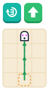 | `3F` | répéter 3 fois : avance. Avance de trois cases (comme `FFF`), arrive en `(0, 3)`. |
| 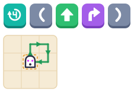 | `4(FR)` | répéter 4 fois le groupe « avance, tourne à droite ». Dessine un carré et revient au départ, tourné vers le haut. |
| 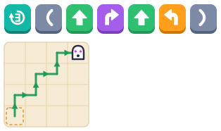 | `3(FRFL)` | répéter 3 fois « avance, droite, avance, gauche ». Monte un escalier vers la droite, arrive en `(3, 3)`. |
| 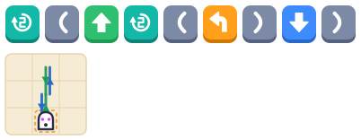 | `2(F2(L)B)` | répéter 2 fois : avance, (répéter 2 fois gauche : un demi-tour), recule. Une répétition dans une répétition : `FLLBFLLB`, revient en `(0, 0)`. |
| 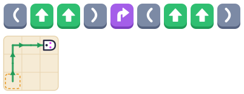 | `(FF)R(FF)` | un groupe seul ne change rien. `FFRFF` : arrive en `(2, 2)`, tourné vers la droite. |

**La carte « si » : faire la carte (ou le groupe) suivante seulement si le sol a cette couleur**

| Cartes et parcours | Programme | Ce que fait le robot |
| --- | --- | --- |
|  | `rF`<br>sol : rouge en `(0, 0)` | si le sol est rouge, avance. Le robot est sur du rouge : il avance d'une case. |
|  | `rF`<br>sol : pas de rouge | l'avance est **sautée**, le programme finit aussitôt : le robot ne bouge pas, et n'attend rien. |
| 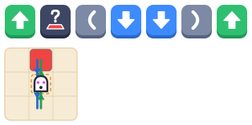 | `Fr(BB)F`<br>sol : rouge en `(0, 1)` | avance ; si rouge, (recule deux fois) ; avance. `FBBF` : avance sur le rouge, recule de deux cases, avance : revient en `(0, 0)`. |
| 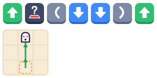 | `Fr(BB)F`<br>sol : pas de rouge | le groupe est sauté : `FF`, arrive en `(0, 2)` sans attendre. |
| 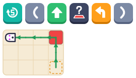 | `5(FrL)`<br>sol : rouge en `(0, 2)` | 5 fois : avance ; si rouge, tourne à gauche. Avance de deux cases, tourne à gauche sur le rouge, continue vers la gauche : arrive en `(-3, 2)`. |
| 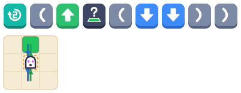 | `2(Fg(BB))`<br>sol : vert en `(0, 1)` | 2 fois : avance ; si vert, (recule deux fois). Premier tour : sur le vert, il recule de deux cases ; second tour : la case n'est pas verte, le groupe est sauté. Arrive en `(0, 0)`. |
| 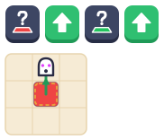 | `rF gF`<br>sol : rouge en `(0, 0)` | deux « si » côte à côte, chacun avec sa carte. `F` : le premier est vrai, le second est faux. |
| 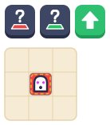 | `rgF`<br>sol : rouge en `(0, 0)` | si rouge, (si vert, avance). Ne fait **jamais** rien : une case n'a qu'une couleur. |

**La répétition avec une couleur (« tant que ») : recommence tant que le sol a cette couleur**

| Cartes et parcours | Programme | Ce que fait le robot |
| --- | --- | --- |
| 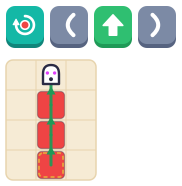 | `E(F)`<br>sol : rouge en `(0, 0)`, `(0, 1)`, `(0, 2)` | tant que le sol est rouge, avance. Suit la bande rouge et s'arrête sur la première case qui n'est pas rouge : `(0, 3)`. |
| 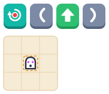 | `E(F)`<br>sol : pas de rouge | ne bouge pas : le sol n'est pas rouge dès le départ. |
| 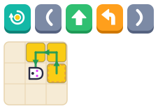 | `Y(FL)`<br>sol : jaune en `(0, 0)`, `(0, 1)`, `(-1, 1)` | tant que jaune : avance, tourne à gauche. `FLFLFL` : tourne autour des cases jaunes, s'arrête en `(-1, 0)` (pas jaune), tourné vers la droite. |
| 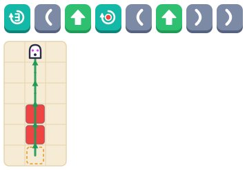 | `3(F E(F))`<br>sol : rouge en `(0, 1)`, `(0, 2)` | 3 fois : avance, puis tant que rouge avance. `FFFFF` : au premier tour la boucle suit la bande rouge jusqu'en `(0, 3)`, aux autres le sol n'est pas rouge : arrive en `(0, 5)`. |
| 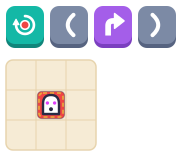 | `E(R)`<br>sol : rouge en `(0, 0)` | tant que le sol est rouge, tourne à droite. **Ne s'arrête jamais** : le sol sous le robot reste rouge. Appuyer sur **Stop**. L'action d'une boucle « tant que » doit pouvoir changer ce que voit le robot. |

**Programmes incomplets : ils veulent dire quelque chose quand même**

| Cartes | Programme | Pourquoi, et ce que fait le robot |
| --- | --- | --- |
| 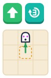 | `F3` | une répétition sans carte après elle est ignorée. `F`. |
| 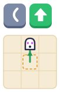 | `(F` | un groupe non fermé se ferme à la fin. `F`. |
| 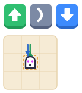 | `F)B` | une `)` sans `(` est ignorée. `FB`. |
| 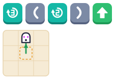 | `3(2)F` | une répétition dont la carte est vide ne fait rien. `F`. |
| 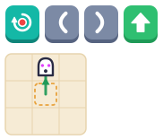 | `E()F` | un « tant que » sur un groupe vide ne fait rien (pas de boucle sans fin sur une carte oubliée). `F`. |

## Les cartes à imprimer

[`docs/cartes-thymio.pdf`](docs/cartes-thymio.pdf) est un PDF de **5 pages A4** pour travailler en classe sans écran,
puis avec le robot. Les cartes ont les couleurs et les pictogrammes de l'application, et **aucun mot** :

| Page | Contenu |
| --- | --- |
| 1 | Comment imprimer et découper, comment programmer avec les cartes, ce que fait chaque carte |
| 2 | **Cartes de base** (24) : avance ×8, recule ×4, tourne à gauche ×4, tourne à droite ×4, et les cartes **Départ** ×2 et **Arrivée** ×2 |
| 3 | **Groupes et répétitions** (24) : `(` ×6, `)` ×6, répéter ×2 à ×9 (une carte de chaque, et un deuxième jeu de ×2 à ×5) |
| 4 | **Couleurs** (16) : « si le sol est… » et « répéter tant que le sol est… » dans les huit couleurs du capteur |
| 5 | **Les cartes en grand** (11, pas à découper) : une carte de chaque sorte — Départ, Arrivée, avance, recule, gauche, droite, début et fin de groupe, répéter, répéter avec une couleur, « si » — de 62 mm, à montrer devant la classe (ou à projeter) |

Imprimer en **A4 à 100 %** (« taille réelle », sans « ajuster à la page »), recto seul : les cartes mesurent
45 mm et ont 3 mm de marge blanche, il est inutile de couper juste. Pour qu'elles durent : plastifier la feuille
avant de découper, ou la coller sur du carton. Le PDF est fait par `npm run docs:cards`
(`scripts/cards-sheet.mjs` pour les pages, `scripts/make-cards-pdf.mjs` pour l'impression par Chrome, qui doit
être installé ou dont le chemin est donné dans `CHROME`) ; pour changer le nombre d'exemplaires de chaque carte,
modifier `SHEETS` dans `scripts/cards-sheet.mjs`, puis relancer la commande. `tests/cards-sheet.test.js` vérifie
que toutes les cartes du langage y sont, qu'aucune ne porte de mot, et que le PDF a bien 5 pages A4.

## Une grille A0 pour le sol

Une affiche **A0 portrait (841 × 1189 mm)** de **cases de 15 cm**, pour faire un sol sur lequel le robot roule :
5 colonnes (A à E) et 7 lignes (1 à 7), un **point de 5 mm** au centre de chaque case, et des **lettres et des numéros sur les
quatre bords** pour retrouver une case (« C4 » est la troisième colonne, la quatrième ligne ; A1 est en haut à gauche, comme
sur la carte Thymio). Deux versions, chacune en **PDF à imprimer** et en **SVG à modifier** :

| | PDF (à imprimer en A0) | SVG (à modifier) |
| --- | --- | --- |
| **Grille vide** : les cases blanches, les points, les lettres | [`docs/grille-a0.pdf`](docs/grille-a0.pdf) | [`docs/grille-a0.svg`](docs/grille-a0.svg) |
| **Exemple « ville »** : des cases en couleur (vert, violet, rouge, jaune, bleu ou blanc) et onze lieux dessinés dans un coin des cases (phare, immeuble, caserne, hôpital, maison, cabane, ferme, musée, château, magasin, école) | [`docs/grille-a0-ville.pdf`](docs/grille-a0-ville.pdf) | [`docs/grille-a0-ville.svg`](docs/grille-a0-ville.svg) |

Les SVG s'ouvrent avec Inkscape (gratuit), Illustrator, Affinity ou Figma (une unité = 1 mm dans la grille vide ; Illustrator
enregistre en points et supprime les calques vides, sans conséquence). L'exemple « ville » est la grille vide complétée :
c'est un modèle pour en faire d'autres, en changeant les couleurs et en déplaçant ou remplaçant les lieux. Les calques de la
grille vide, du bas vers le haut :

1. **Couleurs des cases** : un carré blanc de 15 cm par case (`cell-A1` à `cell-E7`). Lui donner une couleur de remplissage
   colorie **toute la case**.
2. **Lieux et détails** : vide. On y dessine les lieux (maison, école, zoo…) **dans un coin d'une case** : ils sont au-dessus
   de la couleur de la case, et sous la grille et le point, qu'ils ne cachent donc pas.
3. **Grille**, 4. **Points** au centre, 5. **Lettres et numéros** du bord.
6. **Palette** des huit couleurs du capteur du robot, **hors de la page** (visible dans l'éditeur, jamais imprimée).

Pour obtenir un PDF après des modifications : l'exporter depuis l'éditeur (en gardant le format A0), ou imprimer le SVG par Chrome :
`npm run docs:grid` fait `docs/grille-a0.pdf` depuis `docs/grille-a0.svg`, et `node scripts/make-grid-a0.mjs docs/grille-a0-ville.svg`
fait `docs/grille-a0-ville.pdf` ; dans les deux cas le SVG n'est pas touché. La grille vide de base est refaite par
`node scripts/make-grid-a0.mjs --new` (**il remplace `docs/grille-a0.svg`**). `scripts/grid-a0.mjs` fabrique le dessin de base
et `tests/grid-a0.test.js` vérifie sa géométrie (cases de 150 mm, points de 5 mm au centre, lettres, calques) et que les deux
SVG et les deux PDF sont bien des pages A0.

## Partager la configuration : le code QR

Pour la classe : une page peut **afficher en grand le code QR de toute sa configuration**, et les autres
pages le **scannent** pour être réglées à l'identique. Deux boutons dans la barre du haut :

- **le code QR** (blanc, à côté du logo des réglages) affiche le code par-dessus l'application, aussi grand que l'écran le permet (un
  toucher ou Échap le ferme) ; c'est une image du moment, qui ne suit pas les changements d'après ;
- **le bouton bleu** (un œil dans un viseur, à côté du bouton blanc : « appuie sur le bouton bleu ») ouvre la caméra pour scanner le code d'une autre page : le cadre devient vert et la
  configuration est appliquée (un code d'ailleurs fait clignoter le cadre en rouge, sans rien changer). Si la caméra est
  refusée ou absente, ou si le code arrive en image (une capture d'écran, une photo), le bouton « image » en bas du scanner lit un code
  dans une photo. Le scan est impossible pendant que le robot joue.

**Faire ouvrir l'application sur les tablettes.** Les réglages (logo en haut à gauche) ont une ligne « Élèves » avec deux
boutons, chacun affichant en grand, par-dessus l'écran, un code QR (un toucher ou Échap le ferme) que les élèves scannent avec
l'appareil photo de leur tablette :

| Bouton | Ce que contient le code | Ce qu'il faut |
|---|---|---|
| **Code QR générique** | l'adresse de la démo, <https://francescomondada.github.io/thymio3-cards/> (33 modules) | rien : la page s'ouvre dans le navigateur choisi par l'appareil |
| **iOS · Bluefy** | `bluefy://open?url=` suivi de l'adresse encodée (37 modules), le schéma de Bluefy, le navigateur de l'App Store qui sait parler Bluetooth sur iPhone et iPad | Bluefy installé |

Le générique suffit pour le robot virtuel, dans n'importe quel navigateur. Pour le vrai robot, seuls Chrome, Edge et Samsung Internet
(Android, ordinateur) et Bluefy (iOS) ont le Bluetooth web ; Firefox, Safari et Chrome sur iOS ne l'ont pas. Le code est
toujours l'adresse de la démo sur GitHub, même si la page du professeur tourne ailleurs (ou en `localhost`, que les tablettes
n'atteignent pas) ; les liens (`APP_LINKS`, `src/share.js`) sont construits à partir de la seule constante `APP_URL`, et l'adresse est aussi écrite
en texte sous les boutons, pour la taper à la main. Une fois la page ouverte sur une tablette, le bouton blanc et le bouton bleu de la
barre du haut règlent cette tablette comme celle du professeur.

**Pas de code « Chrome sur Android ».** Il a existé un instant (un lien `intent:` qui nomme Chrome) et a été retiré : l'appareil
photo d'un Samsung, essayé, ne l'ouvre pas, il prend tout ce qui n'est pas un lien web pour du texte. Sur Android, le code générique
ouvre le navigateur de la tablette, qui est Chrome ou Samsung Internet dans presque tous les cas, et les deux ont le Bluetooth web ; sinon le
bandeau rouge des réglages dit quoi installer. **À vérifier sur un iPad** : la forme `bluefy://open?url=` n'est pas documentée par
l'éditeur de Bluefy (on sait seulement que le schéma `bluefy://` existe) et l'appareil photo d'iOS doit la proposer.

**Un nom et l'heure à côté du code, pour le classer.** Un élève affiche son code, l'enseignant le **photographie** et range la photo
ailleurs : il faut donc que la photo dise de qui est le code. Le code de la page (bouton blanc de la barre du haut) porte, **sous
lui, dans la même carte blanche**, un **nom** en gros et la **date et l'heure** (« 29 oct. 2026, 11:42 », dans la langue de la
page, au moment où le code est affiché), noir sur blanc, lisibles sur une photo prise de loin. Même rognée serré, la photo garde le
nom avec le code. Le nom se règle dans les réglages (ligne « Nom sur le code QR », 32 caractères au plus) : au premier lancement,
chaque tablette en reçoit un **tiré au hasard**, par exemple « Renard bleu 42 », « Blue Fox 42 », « Blauer Fuchs 42 » ou « Volpe blu 42 »
(un animal, un adjectif accordé avec lui, un nombre de deux chiffres : 42 animaux × 24 adjectifs × 90 nombres, soit environ **90 000
noms par langue**, de sorte que, dans une classe de 30 tablettes, deux d'entre elles ont le même nom une fois sur deux cents environ, de 0,5 à 0,7 % selon la langue).
Les genres sont **équilibrés** : les animaux ne le sont pas (en français 32 masculins pour 10 féminins), alors le tirage choisit d'abord le
genre grammatical, chacun aussi probable que l'autre (masculin et féminin en français et en italien, avec le neutre en allemand), puis un animal de ce genre ;
sans cela trois élèves sur quatre auraient « Petit renard » en français.
Il est gardé sur la tablette, et le dé à côté du champ en tire un autre ; on peut le remplacer par un prénom (accents compris : c'est du
texte affiché, il n'entre pas dans le code) ou le vider, et seule la date reste. Le même nom est écrit **dans la barre du haut, à
droite des deux boutons de code QR** : c'est le seul texte de l'écran principal, il sert à reconnaître la tablette et suit le champ des
réglages en direct ; sur un téléphone étroit il passe sur deux lignes puis se coupe par « … » plutôt que de pousser le bouton du robot, et il
disparaît quand le champ est vide. **Un seul réglage, « Afficher le nom » (Oui / Non, sous le champ, Oui au départ), montre ou cache le nom aux
deux endroits à la fois** : la barre du haut et la légende du code QR. Sur « Non », le nom reste dans le champ (on le retrouve en revenant à
« Oui ») mais n'est écrit ni en haut ni sous le code, où la date et l'heure restent. Comme le nom, ce réglage est propre à la tablette
(`cards.showname`) : il ne voyage pas dans le code QR de la page. Les codes « application » et Bluefy n'ont pas de légende. Le nom n'est
**pas** dans le code : scanner la photo d'un code règle la page comme avant et ne rapporte pas le nom. Le tirage est dans `src/names.js`
(`tests/names.test.js`).

Ce que contient le code : les **cartes du programme**, le **drapeau d'arrivée**, les **couleurs du sol** peint,
le **mode** (normal, avancé, personnalisé) et les cartes données en personnalisé, la **langue**, le **son**, la
**vitesse** du robot virtuel, le chemin affiché (D), et **l'image sous le tapis** : « Carte Thymio » ou tapis uni
partent tels quels avec les carrés couverts et la case de départ ; une image choisie par l'adulte ne peut pas
voyager dans un code, seuls ses carrés et la case de départ sont appliqués, et seulement sur une page qui a elle-même une image
(sinon son tapis reste). La connexion au robot n'en fait pas partie.

Le texte du code est court (une quarantaine de caractères pour un programme simple, un code de 45 modules, facile à scanner à
travers une salle) :
`T3C1;l=fr;s=1;v=1;m=c;k=FBLR(2r;d=0;p=FF(FR)3F;t=2,-1;f=r:0,2/1,1|g:3,3;w=b,4,4,2,2`
(format `T3C1`, des champs `lettre=valeur` dans n'importe quel ordre ; un champ absent laisse la page comme elle est, un champ
invalide est écarté). Ce qui vient d'un code est lu comme une donnée, strictement (jamais exécuté) : un programme est
nettoyé carte par carte, les nombres sont des entiers à moins de 99 cases du départ. Un sol peint partout (plus d'environ 400 cases)
ne tient pas dans un code : l'écran le dit. La caméra demande une page en **https** (ou `localhost`) et l'autorisation du
navigateur. Le code est dessiné avec [qrcode-generator](https://github.com/kazuhikoarase/qrcode-generator) (niveau de correction M) et lu avec
[jsQR](https://github.com/cozmo/jsQR), tous deux dans l'application même : une fois la page ouverte, afficher et scanner un code ne demande plus de réseau (lecture et affichage sont locaux, le code ne contient aucune adresse). Format et lecture : `src/share.js`, `src/qr.js` ;
boutons : `src/components/TopBar.jsx` ; écrans : `QrShow.jsx` et `QrScan.jsx`.

## Une image sous le tapis

Dans les réglages (le logo en haut à gauche), « **Image sous le tapis** » pose une image sous la grille
de 15 cm, pour y faire évoluer le robot sur une vraie carte (un plan de ville, un parcours dessiné,
une photo de la salle). **Au départ, le tapis est uni** (une image
chargée de dessins fins rend la grille difficile à lire) ; le bouton « **Carte Thymio 4 × 4** » pose la carte de la ville Thymio
([`docs/Tapis_Thymio.png`](docs/Tapis_Thymio.png), 3000 × 3000 pixels, 33 Mo) : l'application en embarque une version
de 1280 pixels (650 Ko, `src/assets/Tapis_Thymio.jpg`), refaite avec
`sips -s format jpeg -s formatOptions 86 -z 1280 1280 docs/Tapis_Thymio.png --out src/assets/Tapis_Thymio.jpg`.
Le robot y part du carré du milieu (colonne C, ligne 2 : le zoo).

1. **Choisir une image** (n'importe quel format que le navigateur lit). Elle est réduite à 2048 pixels
   au plus, gardée par le navigateur (IndexedDB, au même endroit que le reste, sur l'appareil seulement) et
   revient au rechargement de la page.
2. **Dire combien de carrés elle couvre** : colonnes × lignes (de 1 à 40 ; par exemple 4 × 4). À
   l'ouverture, 4 colonnes et le nombre de lignes qui garde les proportions de l'image ; le bouton
   « Proportions de l'image » les rétablit après un changement de colonnes. L'image est étirée sur la
   grille, jamais rognée.
3. **Placer le robot** : le tapis cesse de suivre le robot et montre toute l'image, le haut vers le haut ;
   on **glisse le robot** sur sa case de départ (les cartes sont grisées). La coche verte valide (ou
   Entrée / Échap), la cible recentre le robot au milieu de l'image. « Recentrer le robot » fait la même
   chose depuis les réglages, « Retirer l'image » laisse un tapis uni, « Carte Thymio 4 × 4 » pose la carte de la ville (et sa case de départ).

Le robot part par défaut du carré du milieu (le carré à droite et au-dessus du milieu quand le nombre
est pair), toujours **tourné vers le haut de l'image**. Le repère du programme reste celui du robot (sa
case de départ est `(0, 0)`, comme dans les exemples et dans le mode Python) : c'est l'image qui bouge
sous lui. Quand la case de départ change, ce qui est peint ou planté (le sol coloré du mode avancé, le
drapeau) est déplacé dans l'autre sens, pour rester sur la même case de l'image.

**L'image est le sol du robot virtuel.** Au centre de chaque carré, le robot virtuel lit la couleur
que vous voyez (sur la carte Thymio : blanc à la maison, jaune au supermarché, rouge au restaurant,
chez les pompiers et à l'école, bleu à la police, cyan à la piscine, rien sur les routes grises), ramenée à l'une des huit couleurs des cartes « si » et « tant que » (`src/picturecolor.js`) :
la couleur qui occupe le plus le milieu du carré l'emporte (un trait ou une étiquette n'y change
rien) ; un gris, un carré transparent ou hors de l'image n'ont pas de couleur ; un clair sans teinte
est du blanc, un très sombre du noir. Les teintes sont rangées par **secteurs autour de chaque couleur**
(rouge, jaune, vert, cyan, bleu, violet), et non avec les seuils du capteur du robot : ceux-ci sont
ceux de la teinte du capteur, où le vert d'un écran (teinte 120) serait cyan et son jaune (60) vert. Le pinceau du
mode avancé passe avant l'image, case par case ; le chemin prévu (touche **D**) suit aussi l'image. En
plaçant le robot, un point de la couleur lue s'affiche au centre de chaque carré, pour voir ce
que le robot comprend d'un dégradé ou d'une photo : des aplats de couleur franche marchent le mieux.

**Avec un vrai robot connecté, l'image est cachée** (et le placement impossible) : il lit le vrai sol,
et l'image ne doit pas pouvoir être prise pour le sien. Elle revient à la déconnexion. De même, **le tapis est grisé** : la
page ne connaît pas les couleurs du vrai sol, donc ni le sol peint ni le pinceau ne sont montrés ni utilisés ; si le programme
a une carte « si » ou « tant que », un petit « ? » gris apparaît sur le tapis, et le chemin prévu (touche **D**) n'est pas
dessiné, puisqu'il dépendrait de ces couleurs. Le robot, lui, avance sur le tapis d'après les pas que le vrai robot annonce.

## Comment ça marche avec un vrai robot

Le **mouvement est conduit en Python, sur le robot** : [`src/py/sequence_mode.py`](src/py/sequence_mode.py)
est le mode Séquence du firmware réécrit en MicroPython (état, boucle à 50 Hz, LED, sons, gestes,
télécommande, minuteur de 15 cm, contrôleur de cap, rotations au gyroscope). Le navigateur ne
pilote jamais les moteurs.

```
 cartes ◀═══ le même programme à tout moment ═══▶ mémoire du robot ("FFLR")
   │ un changement, 0,45 s après le dernier                       ▲ │ boutons du robot, gestes
   ▼                                                               │ ▼
 import cards_xxx ; cards_xxx.run("FFLR", 0)  ───────────▶  le mode (cards_xxx.py, installé une fois)
                                                                   │  print("@@prog FFLR") …  (stdout)
 cartes, carte en cours, avatar ◀──────── événements ◀────────────┘
```

**L'interface et le robot portent le même programme à tout moment.**

- **Interface → robot** : un script qui tourne ne peut rien recevoir par les services Bluetooth Python
  et fichiers (ils sont servis par la même tâche MicroPython que celle qui exécute le script, qui ne
  les traite qu'entre deux scripts, et `stdin` n'est alimenté que par l'USB et l'UART). Le programme
  du robot est donc changé par la **mise à jour en direct** (décrite plus bas), 0,45 s après la dernière
  modification des cartes (ajout, suppression, déplacement, tout effacer, exemple), et, quand elle ne
  peut pas avoir lieu (premier démarrage d'un robot, mode quitté, échec), en **relançant le mode** avec
  le nouveau programme. Le robot montre aussitôt le nombre de pas par ses LED Lego. C'est **C'est
  parti !** qui relance avec lecture immédiate. Chaque relance arrête le script, envoie le lanceur et
  redémarre le mode : on l'entend (le firmware joue son petit son de chargement à chaque envoi) et on
  le voit (les LED repartent de zéro). Elle n'a lieu qu'une fois par modification : le robot est considéré comme à jour dès que le mode dit
  `hello` avec le programme envoyé, sans attendre son `@@prog`, et un « script terminé » de l'API,
  qui peut arriver en retard, ne dit rien du mode (seuls ses propres `@@bye` / `@@exit` comptent).
  Un arrêt est confirmé par la notification de l'API, ou par les dernières paroles du script
  (`@@bye`, le `KeyboardInterrupt`) quand elle ne vient pas.
  **Pour que la relance se remarque le moins possible** : le pouls des LED du corps (3,84 s) et la
  lumière qui tourne sur le cercle (2,56 s) repartent **là où ils étaient** : le navigateur calcule
  leur phase sur une horloge commune (`pulsePhase`, en ticks de 20 ms, avec 0,45 s d'avance pour
  le démarrage) et la donne au lanceur (`cards_xxx.run("FFLR", 0, 213)`), le mode allume les LED
  au tout premier tick, avant même de dire `hello`, et l'arrêt n'attend que 40 ms après le
  `@@bye`. Et ce n'est pas seulement le mode : le **lanceur allume lui-même les LED** (le pouls du
  corps, la lumière du cercle, le nombre de pas sur les LED Lego) **avant d'importer le mode**
  ([`src/py/lights.py`](src/py/lights.py), ≈ 600 octets, deux paquets Bluetooth), car importer les
  15 Ko du mode (compilés à chaque fois) prend au robot 0,3 à 0,8 s pendant lesquelles les LED
  resteraient éteintes. Un test compare ces lumières à celles du premier tick du mode (126 programmes
  et phases). Pas pour « C'est parti » (le mode joue aussitôt) ni pour un programme de 50 pas (le mode
  montre alors son animation de mémoire pleine). Restent inévitables : le firmware éteint les LED et les moteurs à la fin de chaque script
  (`turnOffAllSensors()`), un bref noir ; et le petit son de chargement à chaque envoi.
- **Garde-fous** : si le mode s'arrête de lui-même peu après son `hello`, deux fois de suite, il
  n'est plus relancé (on ne tourne pas en boucle sur une erreur) ; il redémarre à la modification
  suivante des cartes ou avec **C'est parti !**. Toutes les secondes, tant qu'un robot est
  connecté, la décision « le robot a-t-il les cartes ? » est reprise (elle ne fait rien quand tout
  est à jour) : un démarrage manqué serait rattrapé.
- **Mise à jour en direct** : changer les cartes **sans relancer le mode** (la voie normale ; la relance est son
  repli). Un seul
  chemin entre le navigateur et un script qui tourne a été trouvé dans le firmware : la commande
  Bluetooth des actionneurs (`setActuatorState` de l'API, celle du cockpit). Elle est traitée par sa
  propre tâche (`bt_rx_tx_task`, toutes les 20 ms), quel que soit le script qui tourne, et écrit entre
  autres l'intensité des quatre LED RGB du corps, que le firmware **mémorise telle quelle** et que
  MicroPython **relit** (`LEDS_RGB(i).get_intensity_red/green/blue()`, qui lisent `Leds_GetBrightness`).
  Les cartes passent donc dans ces LED :
  - **une trame** = douze valeurs de 4 bits (3 canaux × 4 LED) : n° du message, un marqueur à 15 (le
    mode n'écrit jamais 15 sur ce canal, quelle que soit sa lumière), drapeau de dernière trame + n° de
    trame, huit demi-octets de message, somme de contrôle. Le message : le nombre de pas (deux demi-octets)
    puis les pas, 2 bits chacun. 1 trame pour 12 pas, 4 pour 50
    ([`liveFrames`](src/script-core.js) d'un côté, `rx_poll` dans [`sequence_mode.py`](src/py/sequence_mode.py)
    de l'autre) ;
  - le mode lit le canal marqueur à chaque tick, **assemble**, applique, et **répond par la ligne
    `@@prog` habituelle** : c'est l'accusé de réception, vérifié par l'interface ;
  - **un message peut se perdre** (le firmware ne garde qu'une commande à la fois : deux écrites en
    moins de 20 ms, la première disparaît). L'interface attend l'accusé 0,7 s, **renvoie une fois** avec
    un autre numéro de message, puis **relance le mode** (le repli). Après **deux échecs de suite**, elle
    ne réessaie plus jusqu'à la prochaine connexion ;
  - la commande écrit aussi le cercle et les LED Lego (remis tels qu'ils sont : nombre de pas, cercle à
    l'endroit estimé), les moteurs (à 0), un son (aucun) ; le mode remet ses propres lumières au tick
    suivant, **au plus 20 ms plus tard** : un éclair possible des LED du corps, au lieu du noir d'une
    relance. Un Bluetooth à 4 bits ne dit pas 16 (la pleine luminosité du mode) : 15 ;
  - **le robot fait un petit clic** à chaque vraie modification (le son embarqué n° 12, « flèches »,
    `SND_UPDATE` dans `sequence_mode.py`, `-1` pour aucun ; le n° 55 « rond » ou le n° 3 « beep » sont
    d'autres sons courts), comme pour un bouton : plus de son de chargement puisque rien n'est envoyé.
    Pas pour un message renvoyé ni pour les mêmes cartes. **L'accusé part avant le son** : démarrer le
    lecteur audio peut prendre du temps, et un accusé en retard ferait renvoyer les cartes puis relancer
    le mode, avec le bip de chargement du firmware (un test le garantit). Le clic décodé comme le fait
    le robot : 88 ms de silence, puis ≈ 24 ms de claquement net, puis un reste très faible ;
  - seulement quand le mode **attend des cartes** (pas pendant une lecture, pas en effaçant), et
    jamais pour le premier démarrage d'un robot ni quand le mode a été quitté ;
  - le journal de la connexion dit ce qui se passe : `live update "FLR": 1 frame`, `live update
    acknowledged after 100 ms`, ou `live update failed …: starting the mode again instead`. Avec
    `?fakerobot`, `window.fakeRobot.flags.live = 'drop'` (trames perdues) ou `'garble'` (une valeur
    fausse) fait passer le robot de démonstration par le repli.
  **Essayé sur un vrai robot (octobre 2026) : ça marche.** Les tests vérifient en plus, sans robot, que
  le mode Python décode les trames écrites par le vrai encodeur JavaScript (40 programmes tirés au
  hasard compris), ignore les trames fausses ou incomplètes, supporte une trame perdue suivie d'un
  renvoi, et joue son clic une fois par changement.
- **Pourquoi c'est rapide** : envoyer le mode entier (≈ 15 Ko) prenait ≈ 5 s à chaque fois (mesuré
  sur un vrai robot, 510 octets par paquet). Il est maintenant **installé une seule fois sur le robot**
  comme module (`cards_<empreinte>.py`, conservé dans sa mémoire ; l'empreinte du contenu fait
  changer le nom quand le mode change, l'ancienne version est supprimée), et chaque démarrage ne
  envoie que deux lignes : `import cards_xxx` et `cards_xxx.run("FFLR", 0)`. Si le module ne peut
  pas être installé ou importé, l'interface envoie le mode entier, comme avant.
- **Robot → interface** : des lignes `@@mot …` sur stdout (`hello`, `cal`, `bat`, `prog`, `state`,
  `step`, `moved`, `end`, `exit`, `bye`). Les pas enregistrés avec les boutons **du robot**, ceux
  effacés en le couchant, reviennent sur l'écran (`prog`) ; une lecture lancée depuis le robot
  (main sur les capteurs arrière, télécommande) est suivie à l'écran. Si les cartes viennent
  d'être modifiées ici, elles sont en route vers le robot et l'emportent.
- **Pas de latence de 1 s** : le firmware n'envoie stdout que par paquets d'au moins 100 octets ou
  après 1 s de silence. Chaque ligne d'événement est donc complétée par des espaces jusqu'à 100
  octets et terminée par `\x1e` (séparateur d'enregistrement) au lieu d'un retour à la ligne, qui
  n'arriverait qu'avec le paquet suivant : la ligne part tout de suite.
- **À la connexion** : l'interface arrête ce que le robot pourrait encore exécuter (la page
  précédente), vérifie ou installe le module, puis démarre le mode : le robot montre ses couleurs
  magenta et cyan qui pulsent et son cercle de LED qui tourne. L'icône du robot, en haut à droite :
  gris aux LED éteintes (pas connecté), ondes bleues qui clignotent (connexion, puis démarrage du mode
  sur le robot), puis, **quand le robot est prêt, la coche verte et la batterie apparaissent ensemble**
  (la coche ne dit pas seulement que le Bluetooth répond : le mode tourne et le robot a donné sa batterie ;
  jusque-là le bouton n'est pas vert), vert aux ondes qui bougent (le robot reçoit les cartes), vert
  aux LED éteintes (prêt, mode pas en marche), croix rouge (ce navigateur ne sait pas se connecter).
  Si le mode n'a pas pu démarrer, les ondes s'arrêtent, sans coche ni batterie. Un appui sur l'icône d'un robot connecté demande confirmation avant de déconnecter
  (✕ reste connecté, ✓ déconnecte ; la page de l'adulte a aussi son bouton). La version du
  micrologiciel est lue en parallèle, sans que le reste l'attende (`getFirmwareInfo()` n'a pas de
  délai maximum dans l'API).
- **Stop** arrête le script ; le mode redémarre aussitôt pour que le robot reste en phase. Le bouton
  central du robot quitte le mode comme dans le firmware ; il ne redémarre alors qu'à la
  modification suivante des cartes ou à **C'est parti !**.
- Un arrêt demandé par l'interface se termine par un `Traceback … KeyboardInterrupt` imprimé par le
  firmware : c'est attendu, l'interface le lit comme un tout et ne le prend pas pour une erreur (c'était
  le triangle d'avertissement qui apparaissait de temps en temps).

Le script complet, avec le programme en cours, s'affiche et se télécharge dans le panneau « Pour les
grands » (l'icône du robot orange, en haut à gauche) : il tourne tel quel dans n'importe quel outil MicroPython pour Thymio 3.

> Un canal plus large vers le script en cours (par exemple une caractéristique BLE qui alimente
> `stdin_ringbuf` côté firmware) remplacerait les LED de la mise à jour en direct : seuls
> `RobotBackend.live()` et `rx_poll` seraient à changer.

## Déboguer la connexion

Réglages (icône du robot orange, en haut à gauche) → **Journal de la connexion** : chaque étape avec sa durée. `⇨` ce que
l'interface envoie (taille du script, exécution, arrêt), `⇦` ce que le robot renvoie sur stdout,
`·` les événements de l'API (connexion, chargement du script, fin du script), `✖` les erreurs.
Les mêmes lignes sont dans la console du navigateur, préfixées `[robot]`. Boutons : **Tester le
robot**, **Copier le journal**, **Effacer**.

Les lignes `· sync: …` disent **ce que l'interface décide** pour donner les cartes au robot, une
seule fois par décision : « FFLR to be given to the robot in 450 ms (it holds FFL, mode running) »,
« starting the mode with FFLR », « waiting: a run is being sent or played », « the robot holds the
cards: FFLR », « not starting the mode by itself … » (le mode a été quitté exprès ou a échoué).
Si le robot ne reçoit pas les cartes après la connexion, c'est la dernière de ces lignes qui dit
pourquoi.

**Sans robot** : ouvrir la page avec `?fakerobot` à la fin de l'adresse (`http://localhost:5175/?fakerobot`)
remplace le Bluetooth par un robot de démonstration qui a l'interface de l'API et les habitudes du
firmware (un envoi de 15 Ko prend ≈ 5 s, stdout par paquets, `Traceback` à l'arrêt, module conservé
dans les fichiers du « robot »). Toute l'interface (connexion, relance à chaque carte, C'est parti,
Stop, journal) fonctionne dans le navigateur, et `window.fakeRobot` permet de jouer le côté du robot
(`press('F')`, `exit()`, `flags.dropStatus = true`…).

**Tester le robot** envoie un minuscule script (les 4 LED du dessus clignotent en vert, deux lignes
sont imprimées) et rapporte le temps d'envoi, de démarrage et de fin. Il sépare « la liaison ne
marche pas » (le test échoue aussi) de « le mode ne démarre pas » (le test réussit, le mode non :
erreur Python, mémoire ou firmware trop ancien, qui apparaissent dans le journal).

**`NotSupportedError: GATT operation failed for unknown reason`** (console et journal) : le navigateur
n'a pas réussi à parler au robot, avant tout script. L'API n'échoue pas bruyamment : elle écrit
l'erreur dans la console et annonce « déconnecté » ; l'interface écoute la console pendant la
connexion pour la recopier dans le journal et dans « Dernière erreur ». Causes habituelles : le
robot est encore connecté ailleurs (autre onglet, cockpit, Thymio Suite, démo de l'API, ou la
session précédente de cette page, que le robot garde jusqu'à la fin de son délai de supervision),
un cache Bluetooth du système obsolète. À essayer : fermer les autres onglets et programmes
connectés au robot, éteindre et rallumer le robot, couper et remettre le Bluetooth de
l'ordinateur. Si le cockpit se connecte au même robot depuis le même navigateur et pas cette
page, alors le problème vient d'ici : envoyez-moi le journal.

**Un lien qui se dégrade** (l'info firmware reste sans réponse, un arrêt ou un envoi échoue en
`GATT operation failed`, un envoi prend une demi-minute, puis `RangeError: Offset is outside the
bounds of the DataView` dans `handleStreamResponse` de l'API) : le firmware envoie les capteurs à
50 Hz tant que le flux a été activé par un client (le cockpit le fait), et **ne le remet pas à zéro à
la déconnexion** (`BLE_GAP_EVENT_DISCONNECT` éteint les LED et les moteurs, pas les drapeaux
`bt_*_sensors_stream_en`). Le client suivant se connecte donc à un robot qui inonde déjà le lien.
Cette interface n'utilise pas ces flux : à chaque connexion elle commence par les couper
(`stopSensorStreaming`, ligne « sensor streaming off » du journal), avant d'arrêter un script
oublié et d'installer le module. Si le lien reste mauvais malgré cela, éteindre et rallumer le robot.

Ce que dit le code du firmware, utile pour lire le journal :

- stdout n'est pas envoyé ligne par ligne : le robot regroupe le texte et l'émet par paquets d'au
  moins 100 octets, ou après 1 s sans nouveau texte (`ble_stdout_task`). Le premier `@@hello`
  arrive donc environ une seconde après le démarrage du script, et `@@step` / `@@moved` avec jusqu'à
  une seconde de retard.
- le robot ne lance un script que s'il n'en exécute pas déjà un ; l'interface arrête donc le script
  résident (`stopScriptExecution`) et attend sa fin avant d'en envoyer un autre.
- `thymio-connected` est émis deux fois par connexion ; le journal indique quand le second est ignoré.

Autres pistes : `chrome://bluetooth-internals` (liaison, services, notifications), et le script
téléchargeable depuis les réglages, à lancer dans l'éditeur Python de la
[démo de l'API](https://mobsya.github.io/thymio3-ts-api/) pour voir ce que dit le robot hors de
cette interface.

## Statut — à lire

**Essayé sur un vrai robot Thymio 3 (octobre 2026) : tout fonctionne** : connexion, installation du
module, cartes, mise à jour en direct des cartes sans relancer le mode (avec un petit clic sur le robot),
relance quand il le faut, lecture, arrêt, et programme identique des deux côtés.
Les durées relevées dans le journal de la connexion : module installé une seule fois en ≈ 5 s
(15 Ko, paquets de 510 octets), puis lanceur envoyé en 50 à 200 ms et `hello` du mode au bout de
0,3 à 0,8 s. Les problèmes rencontrés pendant cet essai (liaison encombrée par les flux de capteurs
d'un client précédent, faux avertissements, relances en double, envois trop longs) sont corrigés et
documentés dans « Déboguer la connexion ».

Ce qui est vérifié en plus, sans robot, par les tests :

- `tests/test_sequence_mode.py` fait tourner le **vrai script** sur un robot virtuel
  (`tests/fake_robot.py` : cinématique, gyroscope en ticks, minuteur matériel, contrôleur d'angle du
  firmware) : carré qui se referme, 15 cm à ±6 mm, virages à ±1,5°, ligne droite tenue à
  0,4° près avec 6 % d'écart entre moteurs (sans le contrôleur, le même écart fait dériver de 5° par trajet), pauses de 0,5 s / 0,7 s même si la boucle est lente,
  enregistrement par boutons et télécommande, effacement par gestes, arrêt propre (moteurs,
  rotation, LED, comportements rendus au firmware).
- `tests/render.test.js` fait le rendu des composants côté serveur (réglages dans les 4 langues, états
  du bouton de connexion) et vérifie la règle de l'écran principal : aucun texte.
- `tests/sim.test.js` vérifie que le simulateur de l'interface suit la même chronologie que le
  script, à la milliseconde, et `tests/live.test.js` fait passer ce script, tel que l'interface le
  construit, par le chemin Bluetooth (API simulée, stdout découpé en morceaux de 11 octets).
- Les appels MicroPython utilisés ont été relus dans `ref/mp/ports/esp32/thymio_*.c`.

Pas encore vérifié : la précision des 15 cm et des 90° mesurée à la règle sur le sol (les tests la
mesurent sur le robot virtuel, l'essai réel n'a montré aucun défaut visible), d'autres versions du
micrologiciel que celle essayée, l'iPhone / l'iPad avec Bluefy (voir plus haut), et le mode avancé
sur un vrai robot (voir « Mode avancé »).

## Organisation

| Fichier | Rôle |
| --- | --- |
| `src/py/sequence_mode.py` | Le mode Séquence en MicroPython, qui tourne sur le robot |
| `src/script-core.js`, `src/script.js` | Construction du script (programme embarqué, minification), lecture des lignes `@@` |
| `src/robot/robot-backend-core.js`, `robot-backend.js` | Liaison Web Bluetooth : file d'opérations, module installé sur le robot, lanceur, repli, journal, lecture de stdout |
| `src/robot/sync.js` | Quand le robot reçoit les cartes, et quand ses propres changements reviennent aux cartes (testé seul, avec des minuteries simulées) |
| `src/dev/fake-thymio.js`, `src/api.js` | Robot de démonstration avec l'interface de l'API (`?fakerobot`) ; `api.js` choisit le vrai ou le faux |
| `src/robot/pose-anim.js` | Position estimée du vrai robot sur le tapis, d'après `@@step` / `@@moved` |
| `src/sim/physics.js`, `mode.js`, `sim-backend.js` | Robot virtuel et port JavaScript du mode, mêmes événements |
| `src/spec.js`, `src/program.js` | Constantes du mode et alphabet des cartes, chemin d'un programme sur un sol, exemples |
| `src/lang.js` | Le langage des cartes avancées : compilateur, machine qui l'exécute, trace (même chose que `compile_program` / `Machine` du mode) |
| `scripts/grid-a0.mjs`, `scripts/make-grid-a0.mjs` | La grille A0 de cases de 15 cm : le dessin de base (SVG à modifier) et son impression en PDF par Chrome |
| `scripts/cards-sheet.mjs`, `scripts/make-cards-pdf.mjs` | Les cartes à imprimer : les pages (HTML) et leur impression en `docs/cartes-thymio.pdf` par Chrome |
| `src/share.js`, `src/qr.js` | La configuration de la page en texte pour un code QR (écriture et lecture stricte), le dessin du code et sa lecture dans une image |
| `src/modes.js` | Les cartes à disposition : modes normal, avancé et personnalisé, cartes de la palette, choix d'une carte sélectionnée, exemples compatibles |
| `src/colors.js`, `src/labels.js` | Les huit couleurs du sol, les noms des cartes pour les lecteurs d'écran |
| `src/worldmap.js`, `src/mapStore.js` | L'image sous le tapis : rectangle de l'image dans le repère du robot, case de départ, déplacement du sol peint ; stockage de l'image (IndexedDB) et réduction |
| `src/picturecolor.js` | Les couleurs que le robot virtuel lit dans l'image : pixel → une des huit couleurs, carré par carré, et sol « pinceau d'abord, image ensuite » |
| `src/camera.js` | Le tapis tourne sous le robot : repères, zoom (fixe, ou adapté au chemin), flèche vers le drapeau |
| `src/useDrag.js` | Glisser-déposer au doigt (appui long pour soulever une carte de la piste) |
| `src/components/*` | Tapis, piste de cartes, palette et boutons, barre du haut, panneau adulte (réglages, journal) |
| `src/App.jsx` | État, robot réel ou virtuel, boucle d'animation, clavier |
| `src/i18n.js`, `src/sound.js` | Textes en 4 langues, petits sons WebAudio |
| `tests/` | Tests JavaScript (`node --test`) et Python (`unittest`), robot virtuel |

L'API n'est pas copiée : `package.json` dépend de `github:Mobsya/thymio3-ts-api#main` et
`vite.config.js` pointe sur son point d'entrée TypeScript ; `npm run api:update` prend les
changements.

## Pour les enfants (et les adultes à côté)

- **Aucun texte sur l'écran principal**, seulement des pictogrammes : cartes (couleur et forme),
  drapeau de départ, jauge des 50 cartes, robot virtuel (écran) ou réel (robot), Bluetooth,
  messages du tapis (le robot apprend, remets-le au départ, bravo, attention, liaison coupée).
  Les mots n'existent que pour les lecteurs d'écran (`aria-label`, zone `aria-live` cachée) et dans
  la page de l'adulte, derrière l'icône du robot orange en haut à gauche : langue, sons, exemples, état du robot, dernière
  erreur, script Python.

- **La carte tourne, pas le robot** : le robot est toujours au même endroit de l'écran, tourné vers
  le haut ; c'est le tapis qui glisse et tourne sous lui. Avancer, c'est donc toujours vers le
  haut, reculer toujours vers le bas, comme les flèches des cartes (la flèche bleue de « recule »
  a ainsi un sens clair).
- **Un drapeau d'arrivée** se pose en touchant une case du tapis (un drapeau à damier dans une case
  rose) ; le toucher à nouveau l'enlève. Il ne sert qu'à être vu : le robot n'en tient pas compte.
  Hors de l'écran, une flèche au bord de l'écran, qui tourne avec le tapis, indique sa direction.
- **Remettre le robot au départ** : la touche **R** (ou le bouton « Robot au départ » des réglages, pour un smartphone sans clavier) ramène le robot sur la case de départ, direction
  haut (cela se fait aussi tout seul à chaque modification des cartes et à chaque départ). **Le
  retour se voit** : le tapis glisse et tourne en sens inverse sous le robot (0,45 à 0,95 s, plus
  long si le chemin est long, virage par le plus court côté), puis le robot fait un petit bond en
  arrivant ; rien ne bouge s'il est déjà sur la case départ, ni si le système demande de réduire
  les animations. Avec un vrai robot, le remettre à la main sur la case départ avant de recommencer.
- **Le chemin du robot n'est pas dessiné par défaut** : l'enfant l'imagine. Le tapis ne montre que
  le robot, à zoom fixe sans tenir compte du programme (cadrer le trajet le révélerait). La touche **D** (ou le bouton « Chemin du robot » des réglages) affiche le chemin prévu et la trace déjà parcourue, et cadre tout
  le trajet (le zoom s'adapte pour qu'il reste entier dans l'écran) ; une seconde pression le cache. Il n'y a pas de bouton sur l'écran principal (il ne montre aucun
  texte), mais les réglages ont un bouton « Chemin du robot » (et « Robot au départ » pour la touche R),
  juste après le réglage des sons : un smartphone ou une tablette sans clavier y a accès aussi. Le choix
  n'est pas mémorisé : chaque ouverture repart sans chemin. Les touches sont documentées dans les
  réglages (icône du robot orange → raccourcis clavier).
- Toucher une carte de la palette l'ajoute à la fin ; la glisser l'insère où on la dépose ; glisser
  une carte de la piste la déplace ; la déposer sur la gomme la supprime ; toucher une carte fait
  apparaître sa croix. Sur tablette, une carte de la piste se soulève en la gardant appuyée un
  instant (un balayage fait défiler un long programme).
- Clavier : flèches = cartes, Entrée = c'est parti, Retour arrière = gomme, Échap = stop, R = robot
  au départ, D = chemin. Tout est aussi dans les réglages (icône du robot orange, en haut à gauche).
- Avec un vrai robot, le remettre sur la case départ avant de recommencer : le robot repart de là
  où il est et prend son cap actuel comme cap zéro.
